

### A native Android and iPhone front end and download manager for [gallery-dl](https://github.com/mikf/gallery-dl)

gallery-dl runs *inside the app* (embedded Python), so there is no server, no backend and no account. 
Paste a link, press **Start**, and it becomes a folder you can browse and play, with live video previews.

[Highlights](#highlights) &nbsp;·&nbsp; [Releases](#releases) &nbsp;·&nbsp; [Screenshots](#screenshots) &nbsp;·&nbsp; [Features](#features) &nbsp;·&nbsp; [Limitations](#known-limitations)

 

## Highlights

<table>
  <tr>
    <td width="33%" valign="top"><b>📥&nbsp; Paste, press Start</b> Links are checked against gallery-dl's supported sites. Nothing downloads until you say so, one link at a time, in the background.</td>
    <td width="33%" valign="top"><b>🗂&nbsp; A folder per link</b> Named exactly as gallery-dl names it, or by you: pick the folder before a link starts and it always saves there.</td>
    <td width="33%" valign="top"><b>♻️&nbsp; Refresh without repeats</b> Renew and <i>Check for new files</i> fetch only what the library does not have. Delete a file and the next refresh brings it back.</td>
  </tr>
  <tr>
    <td valign="top"><b>🎞&nbsp; Live previews and a real player</b> Every video loops silently in the library. The player scrubs, zooms, changes speed and locks the screen. WebM plays on iPhone too.</td>
    <td valign="top"><b>⭐&nbsp; Favorites that stay</b> Long-press, tap the star: a copy is kept inside the app with its link and address, even after the link and folder are deleted.</td>
    <td valign="top"><b>📱&nbsp; One design on every screen</b> Android phone, Android TV and iPhone share one look and behaviour. Dark theme, no account, nothing leaves the device but the downloads.</td>
  </tr>
</table>

## Releases

Ready-made apps are on the [Releases page](https://github.com/csngh/gallery-dl-android/releases). Download the one for your device:

| File | For |
| --- | --- |
| `GalleryDL-App-Phone.apk` | Android phone |
| `GalleryDL-App-TV.apk` | Android TV and projectors |
| `GalleryDL-App-iPhone.ipa` | iPhone (unsigned; install with Sideloadly, AltStore or SideStore) |

**Install:** on Android, open the downloaded file and allow installs from your browser or files app when asked. On iPhone, open the `.ipa` in Sideloadly, AltStore or SideStore and sign in with your Apple ID. A free Apple ID works, but the app must be refreshed every 7 days.

## Screenshots

**Android phone**

<table>
  <tr>
    <td>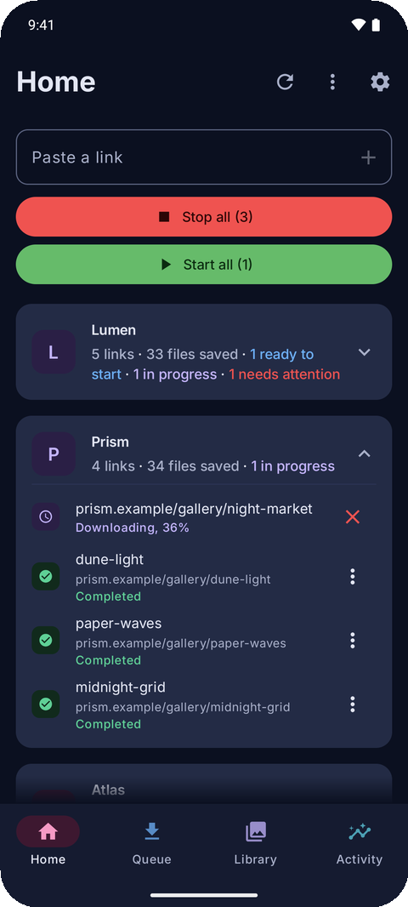</td>
    <td>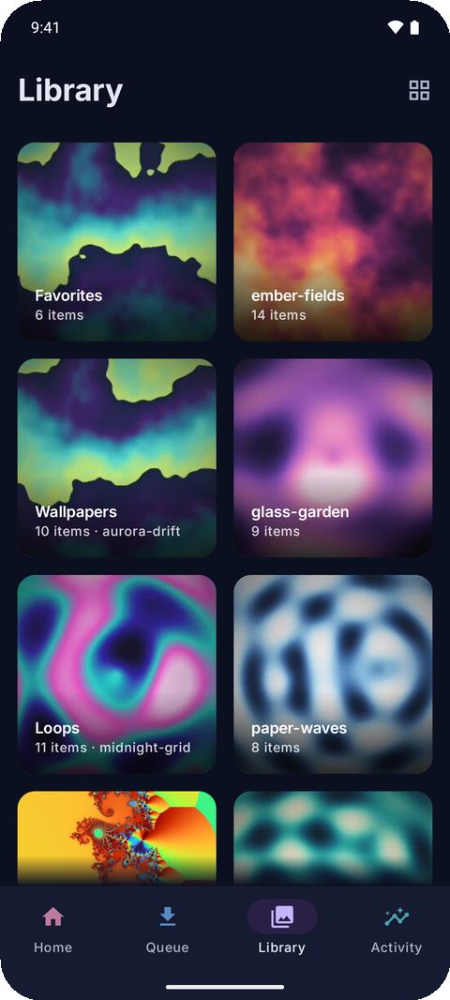</td>
    <td>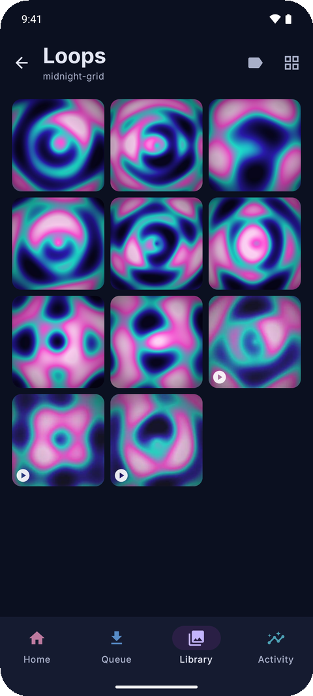</td>
    <td>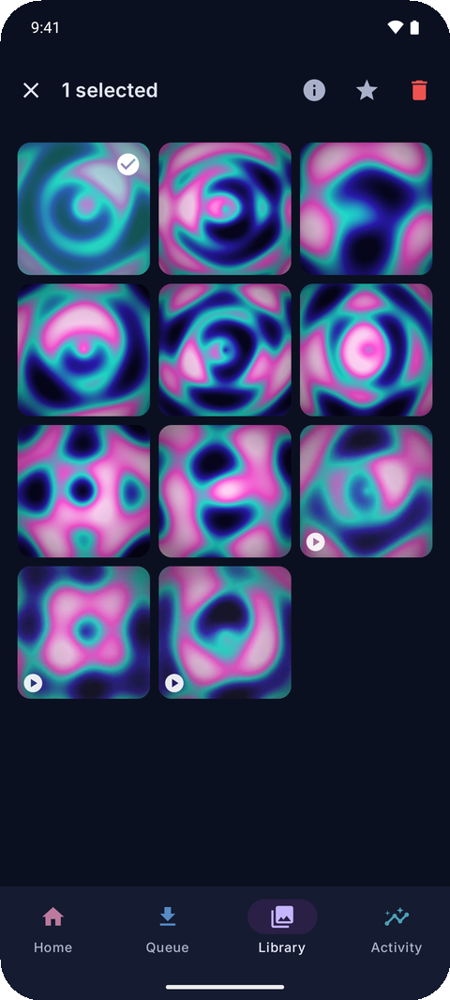</td>
    <td>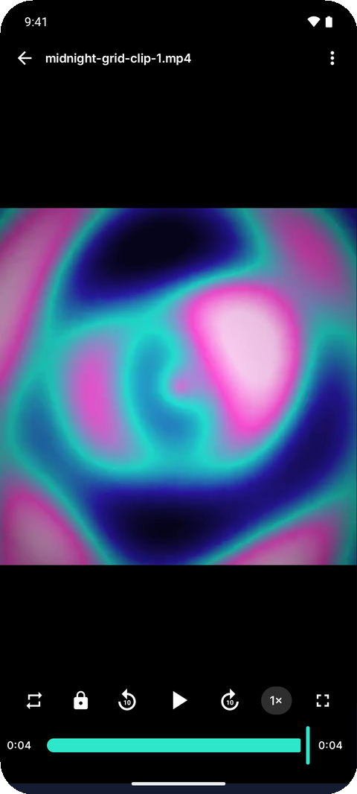</td>
  </tr>
  <tr align="center">
    <td><b>Home</b> links by website, with their folder</td>
    <td><b>Library</b> live previews, tags, Favorites first</td>
    <td><b>Folder</b> 2 to 4 columns, date order</td>
    <td><b>Favorites</b> long-press, then the star</td>
    <td><b>Player</b> scrub, speed, zoom, lock</td>
  </tr>
  <tr>
    <td>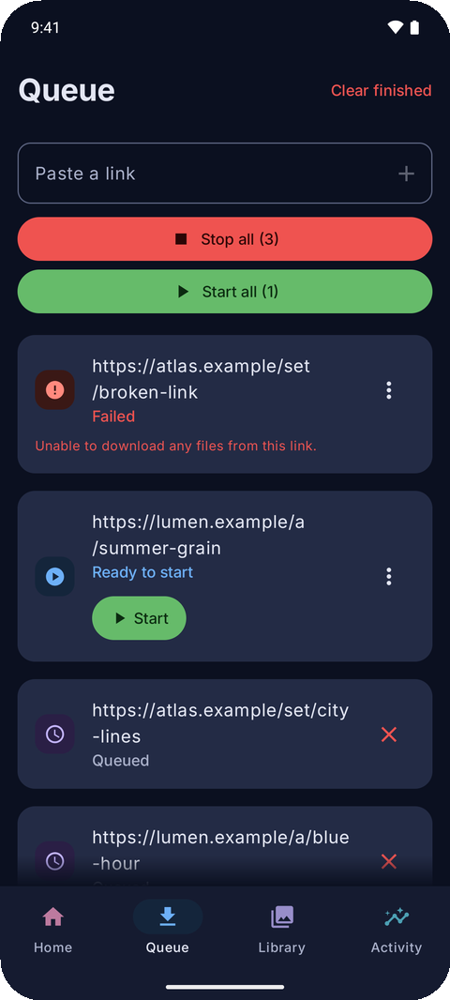</td>
    <td>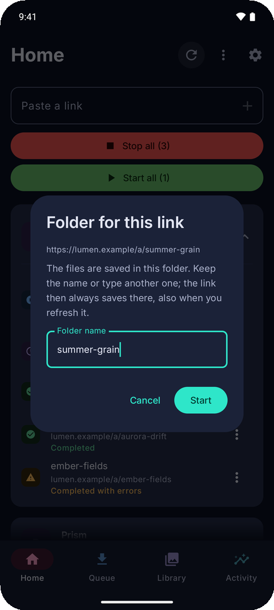</td>
    <td>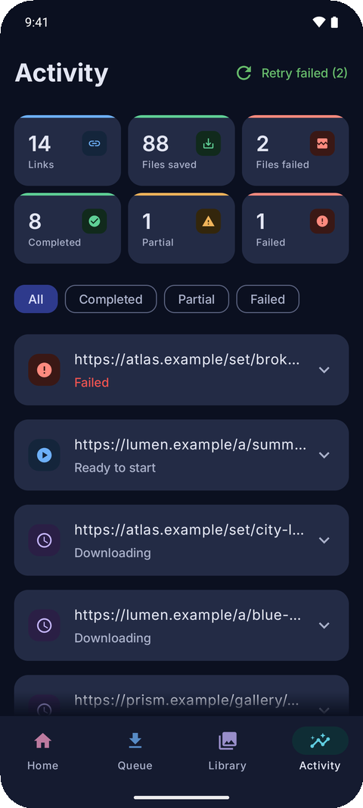</td>
    <td>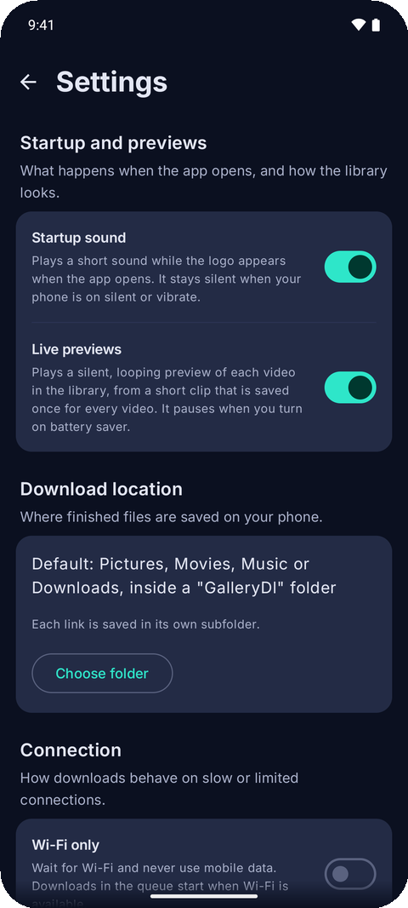</td>
    <td></td>
  </tr>
  <tr align="center">
    <td><b>Queue</b> Start, Stop all, retry</td>
    <td><b>Folder for a link</b> asked before it starts</td>
    <td><b>Activity</b> results and errors</td>
    <td><b>Settings</b> pacing, cookies, storage</td>
    <td></td>
  </tr>
</table>

**iPhone**

<table>
  <tr>
    <td>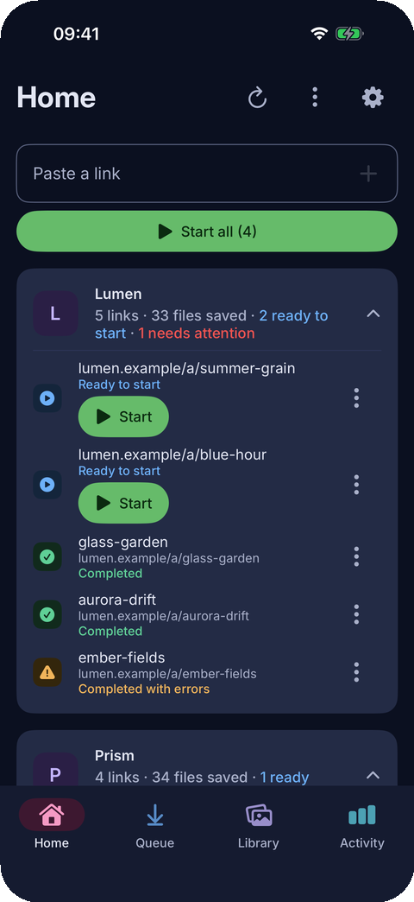</td>
    <td>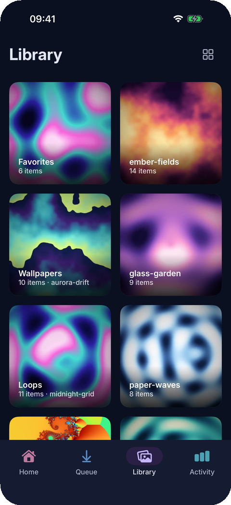</td>
    <td>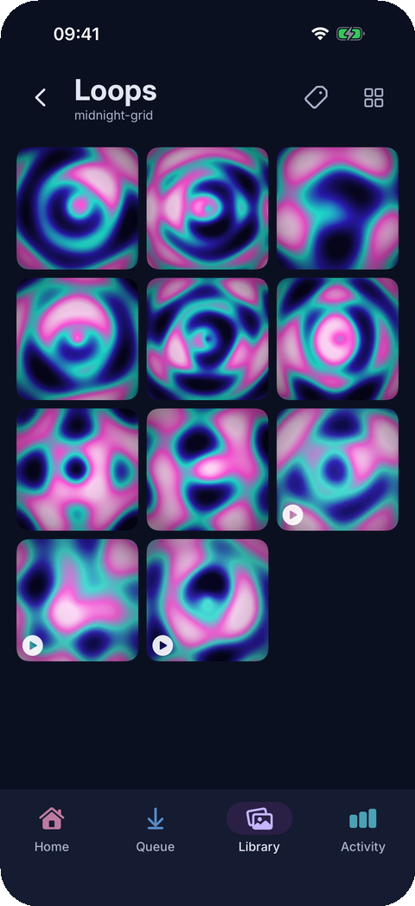</td>
    <td>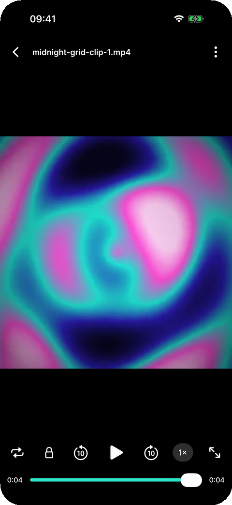</td>
  </tr>
  <tr align="center">
    <td><b>Home</b></td>
    <td><b>Library</b></td>
    <td><b>Folder</b></td>
    <td><b>Player</b></td>
  </tr>
</table>

The pictures and videos in these screenshots are generated abstract art, and the links use placeholder
<code>.example</code> addresses. They are not real downloads.

 

## Features

### Downloading

- **One link at a time.** Paste a link (or share one from a browser); it is checked against gallery-dl's supported
  sites and added. Nothing downloads until you press **Start** (or **Start all**), and one link downloads at a time.
- **Stop all.** A red **Stop all** button on Home and Queue appears while anything is downloading or waiting. One tap cancels the
  running download and every waiting link. Each link keeps its record of what was saved, so a retry only fetches the rest.
- **Live progress.** Overall percent when the site reports an album size, otherwise per-file percent, in the app and in
  a notification with a Cancel button.
- **A folder per link.** Saved to shared storage (Pictures / Movies / Music / Downloads under `GalleryDl/`, no storage
  permission needed) or to a folder you pick.
- **Where a file came from.** In the viewer, the ⋮ menu has **Details**: the link you added and that file's own direct address,
  each with a Copy button. In a folder, long-press a file and an **i** button next to Delete shows the same details. Renewing a link updates the address of every file it covers, including files it already had.
  Files downloaded before this was added show "Not saved" until the link is renewed.
- **No second copies.** Files the library already has for a link are never fetched or saved again, even if you removed the link
  and added it again (which deletes its "already downloaded" record). The existing file just gets the link's new download.
- **Home keeps your links.** Home is the collection of links you have downloaded, not a history. "Clear finished" on the Queue only
  tidies the Queue: the links stay on Home (and in Activity), with their memory of what was saved, so Renew only fetches
  what is new. Settings > Clear history is the one that really deletes them.
- **Renew.** The refresh button on Home runs every link again to pick up new files, and starts links that were only
  added. Files you already have are skipped.
- **Check for new files / Retry.** A finished link can be run again from its menu (or in Activity); a retry only
  fetches what is still missing.
- **Export and import links.** The three-dot menu on Home saves every link to a plain text file (one link per line)
  and reads such a file back. Import skips duplicates and unsupported sites and says how many of each. The same file
  works on the iOS app.
- **Low-storage protection.** When the storage is 99% full, downloads pause (the running link goes back to the queue and
  keeps its progress), a red warning shows on Home and Queue, and a notification says so. They carry on by themselves
  once the storage is below 98.5% again.
- **Download controls.** Wi-Fi-only mode, retries, timeouts, request pacing, and cookies.txt import for sites that need
  a login.

### Library

- **Folders named by gallery-dl.** Each file goes in a folder with exactly the name of the innermost folder gallery-dl
  made for it (a thread's own folder, say), without its parents; direct file links all land in gallery-dl's `directlink`
  folder. A file saved earlier under an older folder name moves into the folder gallery-dl names now the next time its link
  is refreshed (Renew, or adding the link again): nothing is downloaded again (a file counts as already saved by its name or by its direct address, so names with a shifting position number still match), and an emptied old folder is removed, its tag
  passing to the new one. Also search of file names (currently hidden), multi-select delete, and **folder tags**
  (long-press a folder, or use the tag button inside it): the tag becomes the folder's title and its own name moves to the line below it.
- **Live previews.** Every video plays a silent, looping preview, and folder covers cycle through clips from random
  videos in their folder. A preview is a random 3 second window of the video, saved once at the video's own frame rate
  (up to 30 fps) as a short strip of small JPEG frames, so playing it needs no video decoder and about 1-2 MB of
  memory per tile; every visible tile can animate at once. Clips are made right after a download, and a background job
  (it carries on after you leave the Library, shows a quiet notification, waits while the battery is low) makes the
  clips for every video that lacks one, with a "Preparing previews" bar. Thumbnails, previews and website icons are
  kept on the device until the video is deleted or you clear them.
- **Columns.** 2, 3 or 4 columns inside a folder.
- **Folder for a link.** Pressing Start on a waiting link asks which library folder its files go in. The name gallery-dl would use is looked up and filled in; keep it, or type another and that link always saves there, also on every refresh. A name another link already uses gets a warning (it can still be chosen). Start all and Renew do not ask. On Home, each link shows its folder's name as the main text with the link underneath.
- **Files saved.** The count on a link is what the library holds for it, recalculated whenever the link is refreshed.
- **Favorites.** Long-press a file in a folder, then tap the star to copy it into a Favorites folder (pinned first in the Library). The copy is kept inside the app (on Android in the app's private storage, not in your Pictures or Movies), keeps the link and the file's own address (see Details), and stays when the link or its folder is deleted. It goes only when you delete it from Favorites.
- **Folder order.** The folder list can show the newest folder first (the default) or the oldest first, from the grid button in the Library's top bar. The choice is remembered. Inside a folder the files have the same choice, and the full-screen viewer follows it.
- **Built-in video player.** Videos and audio play inside the app (Media3 ExoPlayer): swipe sideways to scrub with a
  live picture and a "+0:12" pill, a seek bar that previews as you drag, playback speed 0.5x to 2x (remembered), pinch or
  double-tap to zoom and drag to pan, tap to hide the controls, a loop button (repeat the video), a lock button (ignores every touch until you unlock it), back and forward 10 seconds, and a rotate-to-landscape button on phones. Formats the phone cannot play fall back to opening
  another app.
- **Entries disappear** when their files are deleted outside the app.

### Android TV

- A separate TV build appears on the TV home screen with a banner and does not need a touchscreen; use a mouse or a
  touch-capable remote.
- Wide screens (TV, tablets, landscape) show the folder list on the left (one column, 20%) and the open folder on the
  right (80%).

### Other

- **Home** groups links by website, with each site's own icon (cached on the device).
- **Activity** shows per-link results (completed / partial / failed), file counts and error details.
- **Settings** cover pacing, website options, download location, connection, accounts (cookies), startup sound, live
  previews, storage and reset.
- **Dark theme only.**

## iPhone (iOS)

The iPhone app has the same screens, wording, colours and behaviour as the Android one. iOS 15 or newer.

### What is ported

Home (links grouped by website, with each site's icon), Queue, Library (folders, tags, 2 to 4 columns, multi-select
delete, swipeable full-screen viewer with in-app video and audio playback), Activity (stats, filters, retry, Check for
new files) and Settings (every option, cookies import, storage, reset). The queue works the same way: nothing starts
until you press Start, one link downloads at a time, a retry only fetches what is missing. Renew, export and import of
links, and the folder tags work as described above.

- **Export** opens the share sheet (save the file to Files); **import** opens the file picker and reports how many
  links were added, were duplicates, were on unsupported sites, or were not links.
- **Website icons** are fetched once and kept in Application Support (a site with no icon is asked again after a week).
- The library search box is hidden for now, as on Android.

### Differences from Android

- **Background downloads.** iOS has no foreground service. Downloads run while the app is open and for a short while
  after leaving it; then the running link goes back to the queue and a notification says so. Keep the app open for long
  downloads.
- **Download location.** Always inside the app; there is no folder picker.
- **Share from the browser** (Android's share popup) needs an iOS share extension, which is not built.
- **Notifications** announce finished links only; iOS cannot update a live progress notification in the background.
- **Preview catch-up** runs only while the Library is open.

## Known limitations

- Private or login-gated content needs a cookies.txt exported from your browser (Settings > Accounts); there is no
  in-app login.
- No overall percentage for links that expand into many other links (profiles, threads); those show per-file progress.
- Images in the viewer cannot be zoomed yet (videos can).
- The library search box is hidden for now.
- On a video page, swiping scrubs instead of moving to the next file; go back to the grid to open another one.
- The TV build is made for a mouse or touch input; it has no remote (D-pad) focus navigation.
- Preview clips are made on the device after a download; on a very slow phone the first visit to a large library takes a
  while (it keeps going in the background).

## Credits

- [gallery-dl](https://github.com/mikf/gallery-dl) by Mike Fährmann does the actual downloading.
- [Inter](https://rsms.me/inter/) font, licensed under the SIL OFL (see [docs/licenses](docs/licenses/Inter-OFL.txt)).
- Screenshot images are abstract art generated with a small script, so there is nothing to attribute.
