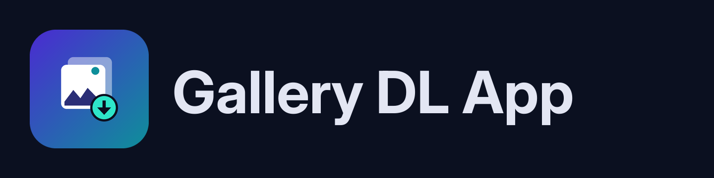

<div align="center">



### A native Android, iPhone and Mac front end and download manager for [gallery-dl](https://github.com/mikf/gallery-dl)

gallery-dl runs *inside the app* (embedded Python), so there is no server, no backend and no account.<br>
Paste a link, press **Start**, and it becomes a folder you can browse and play, with live video previews.

https://github.com/user-attachments/assets/d28a3f1e-f986-4f31-a7db-4adbdf1fa871


</div>

## Highlights

- **Paste, press Start.** Links are checked against gallery-dl's supported sites. Nothing downloads until you say so, one link at a time, in the background.
- **A folder per link.** Named as gallery-dl names it, or by you. Files you already have are never saved twice.
- **Refresh without repeats.** Renew and *Check for new files* fetch only what the library does not have.
- **Live previews and a real player.** Every video loops silently in the library. The player scrubs, zooms, changes speed and locks the screen.
- **Favorites that stay.** Long-press a file (right-click on Mac) and tap the star: a copy is kept inside the app, even after the link and folder are deleted.
- **Enhance video (Mac).** Right-click a short video (up to 25 seconds and up to 1920×1080; a 1080p video is enhanced too, for a cleaner picture rather than a bigger one) and choose *Enhance video*: Apple's machine-learning upscaler (VideoToolbox, macOS 26) makes a sharper version fitted to 1080p. Every frame is kept at its original time, so the frame rate and timing are exactly the source's; nothing is sharpened, denoised or smoothed on top. The color tags and HDR10 metadata are carried over (HDR and 10-bit videos are processed in 10 bits and written as HEVC Main 10), and the result is high-bitrate HEVC with the original sound. It always runs at best quality (shown with an estimated time). Then preview the result in a before/after comparison with a seek bar, a movable close-up, and an optional *Show color charts* panel (brightness histogram, average red/green/blue, key numbers, and the numbers behind them), and choose *Replace original* (same folder, same name) or *Save a copy* (into a new *Enhanced videos* folder). Either way the new file keeps the original's link, added date, file dates, extended attributes and the metadata inside the video (title, creation time and so on). It is slow: roughly 0.7 seconds a frame for 720p video.
- **Extractor plugins.** Import a local `.gdlplugin` file from **Settings → Extractor plugins** to add an extra site. No extra extractors ship with the app. Enable only plugins you trust, then restart Gallery DL. See the [plugin format](docs/extractor-plugins.md) for platform compatibility and packaging.
- **Sync between devices.** Send links and favorites to another phone, TV, iPhone or Mac on the same Wi-Fi.
- **One design on every screen.** Android phone, Android TV, iPhone and Mac share one look; the Mac adds a sidebar, right-click menus and keyboard control. Choose Dark or Light under **Settings → Appearance and startup**. No account; nothing leaves the device but the downloads.

## Releases

Ready-made apps are on the [Releases page](https://github.com/csngh/gallery-dl-app/releases):

| File | For |
| --- | --- |
| `GalleryDL-App-Phone.apk` | Android phone |
| `GalleryDL-App-TV.apk` | Android TV and projectors |
| `GalleryDL-App-iPhone.ipa` | iPhone (unsigned; install with Sideloadly, AltStore or SideStore) |
| `GalleryDL-App-Mac.zip` | Mac with Apple silicon, macOS 14 or newer |

**Install:** on Android, open the downloaded file and allow installs from your browser or files app when asked. On Mac, unzip it, drag **Gallery DL** to Applications, then Control-click it and choose **Open** the first time (the app is not notarized). On iPhone, open the `.ipa` in Sideloadly, AltStore or SideStore and sign in with your Apple ID. A free Apple ID works, but the app must be refreshed every 7 days.

## Building the Mac app

The Mac app shares the iPhone app's engine, library, sync and screens (`ios/GalleryDL`) and adds its own window in `macos/`. Python, gallery-dl and the WebM decoder are bundled, so it needs no installs on the Mac it runs on.

```sh
brew install xcodegen
bash macos/scripts/setup.sh      # once: fetches Python for macOS, installs gallery-dl, builds libvpx, generates the project
bash macos/scripts/make_app.sh   # builds macos/dist/GalleryDL-App-Mac.zip
```

Keyboard: Cmd-1 to Cmd-5 and Cmd-comma switch sections; in the viewer, the left and right arrows change file, space plays and pauses, and Esc closes.

## Known limitations

- Private or login-gated content needs a cookies.txt exported from your browser (Settings > Accounts); there is no in-app login.
- On iPhone, downloads run while the app is open and for a short while after; keep it open for long downloads. On Mac they carry on after the window is closed, until you quit the app.
- The Mac app is built for Apple silicon only and is not sandboxed or notarized, so a Mac other than the one that built it asks you to confirm opening it.
- Large libraries take a while to prepare previews on a slow phone the first time; it keeps going in the background.

## Credits

- [gallery-dl](https://github.com/mikf/gallery-dl) by Mike Fährmann does the actual downloading.
- [Inter](https://rsms.me/inter/) font, licensed under the SIL OFL (see [docs/licenses](docs/licenses/Inter-OFL.txt)).
